# Shared modeled and learned context layer

**Source:** [03:29.50–03:54.37](https://www.youtube.com/watch?v=HtR5m5VjaDQ) · **Template:** architecture-focus · **Type:** explanatory-graphic-or-overlay

**Teaching purpose:** Locate modeled and learned context within the broader architecture.
**Relationship:** system overview → located detail

## Original transcript

> drafting those definitions, and we do that through the Genie ontology. The ontology is a is a unified context layer that gives Genie a a business aware map of your organization. And it brings together two categories of context. We have modeled ontology, and then we have learned ontology. On the modeled side, uh this is really where you need to catalog semantics come into play. It's human-curated context that someone certified and and governed.

Rolling transcript, approximate times and original transcription errors preserved.

## Parameterized teaching pattern

- `At a high level, {{system}} contains {{components}}. Let’s focus on {{component}}.`
- `{{component}} sits between {{upstream}} and {{downstream}} and is responsible for {{responsibility}}.`

**Use when:** Use when placement in the larger system is part of the explanation.
**Choose another approach when:** Use a standalone example when the architecture adds no relevant context.

**Proposed adaptation motion:** Establish the overview, preserve context, move the inner camera or selectively emphasize the active region.

## Source-specific reveal evidence

```json
{
  "status": "Sequence-level source observations are attached in prior_source_observations. The family motion grammar is a proposed reusable pattern, not a frame-exact claim about this instance."
}
```

## Original source states

### 03:29.80 — earlier observed state
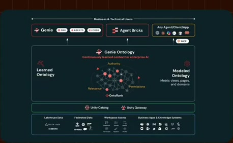
[Full source frame](../frames/full/0006294.jpg)
> drafting those definitions, and we do that through the Genie ontology. The ontology is a is a unified context

### 03:35.00 — intermediate observed state
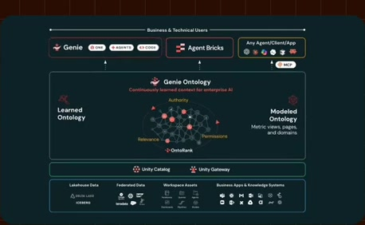
[Full source frame](../frames/full/0006450.jpg)
> The ontology is a is a unified context layer that gives Genie a a business aware map of your organization. And it brings together two categories of

### 03:41.00 — intermediate observed state

[Full source frame](../frames/full/0006630.jpg)
> aware map of your organization. And it brings together two categories of context. We have modeled ontology, and then we have learned ontology.

### 03:48.00 — intermediate observed state
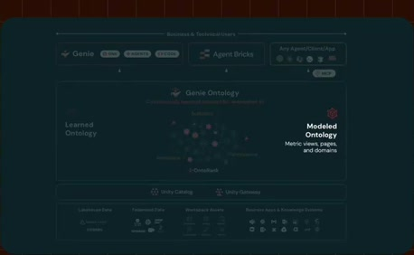
[Full source frame](../frames/full/0006840.jpg)
> On the modeled side, uh this is really where you need to catalog semantics come into play. It's human-curated context

### 03:53.50 — later observed state
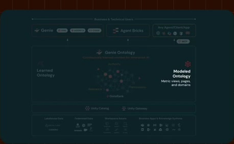
[Full source frame](../frames/full/0007005.jpg)
> into play. It's human-curated context that someone certified and and governed. And there are three components that are

<details>
<summary>4 original change windows: before / near transition / after</summary>

### Estimated anchor 03:29.50

| Before | Near transition | After |
| --- | --- | --- |
| 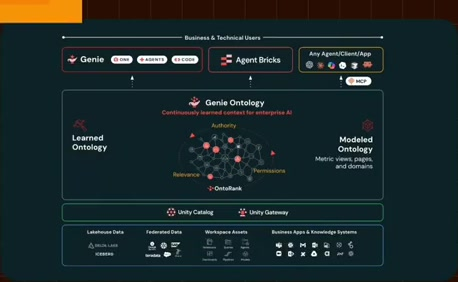 | 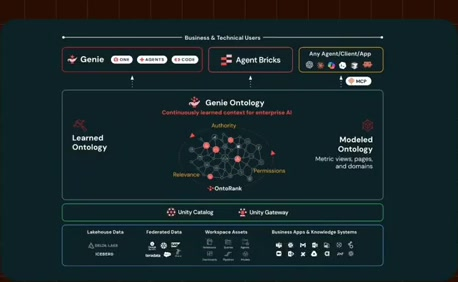 | 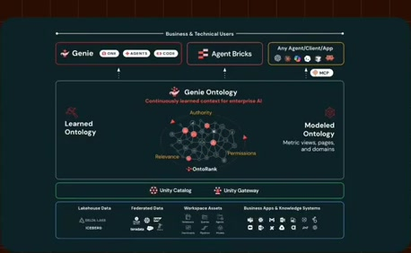 |

> drafting those definitions, and we do that through the Genie ontology. The ontology is a is a unified context

### Estimated anchor 03:35.00

| Before | Near transition | After |
| --- | --- | --- |
| 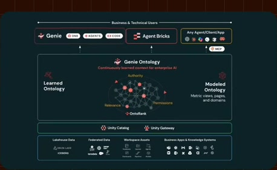 | 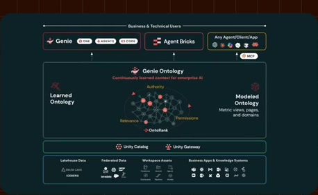 | 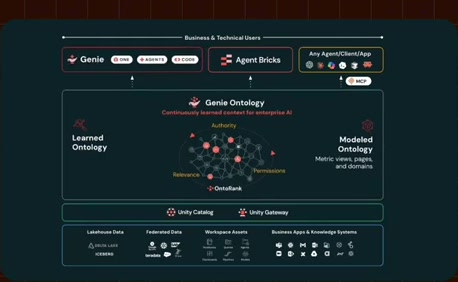 |

> The ontology is a is a unified context layer that gives Genie a a business aware map of your organization. And it brings together two categories of

### Estimated anchor 03:41.00

| Before | Near transition | After |
| --- | --- | --- |
| 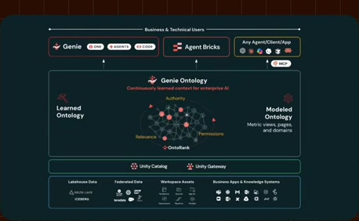 |  |  |

> aware map of your organization. And it brings together two categories of context. We have modeled ontology, and then we have learned ontology.

### Estimated anchor 03:48.00

| Before | Near transition | After |
| --- | --- | --- |
|  | 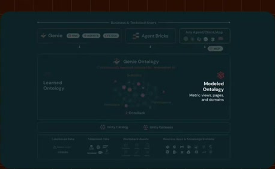 | 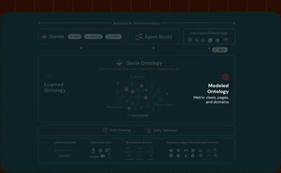 |

> On the modeled side, uh this is really where you need to catalog semantics come into play. It's human-curated context

</details>
