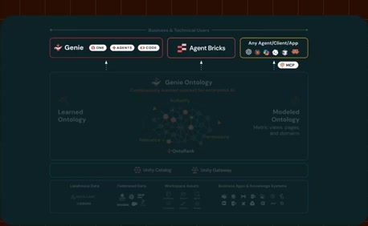
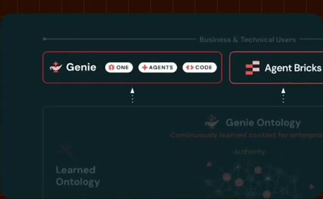
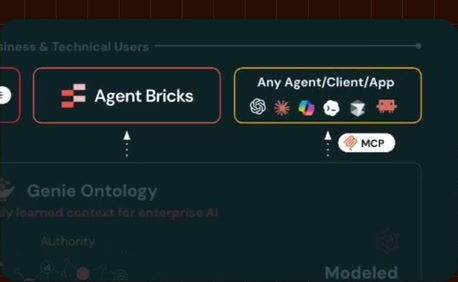
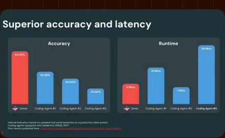
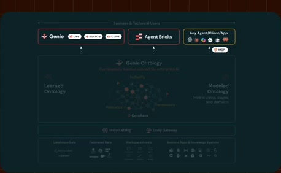
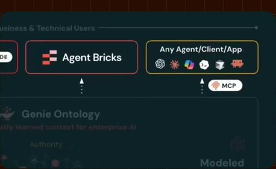

# Consumers share the context layer

**Source:** [07:18.00–07:34.00](https://www.youtube.com/watch?v=HtR5m5VjaDQ) · **Template:** architecture-focus · **Type:** explanatory-graphic-or-overlay

**Teaching purpose:** Return the focused mechanism to the system’s consumers.
**Relationship:** system overview → located detail

## Original transcript

> conflicting information, and so on. And it's not just questions that you put into Genie, it's also any third-party agent that you choose to hook up via our MCP. So, no matter where you're standardizing your end users, you benefit from this semantic layer. And that that benefit is very significant.

Rolling transcript, approximate times and original transcription errors preserved.

## Parameterized teaching pattern

- `At a high level, {{system}} contains {{components}}. Let’s focus on {{component}}.`
- `{{component}} sits between {{upstream}} and {{downstream}} and is responsible for {{responsibility}}.`

**Use when:** Use when placement in the larger system is part of the explanation.
**Choose another approach when:** Use a standalone example when the architecture adds no relevant context.

**Proposed adaptation motion:** Establish the overview, preserve context, move the inner camera or selectively emphasize the active region.

## Source-specific reveal evidence

```json
{
  "status": "Sequence-level source observations are attached in prior_source_observations. The family motion grammar is a proposed reusable pattern, not a frame-exact claim about this instance."
}
```

## Original source states

### 07:18.30 — earlier observed state

[Full source frame](../frames/full/0013149.jpg)
> information, to dedupe against across uh conflicting information, and so on. And it's not just questions that you put into Genie, it's also any third-party

### 07:22.00 — intermediate observed state

[Full source frame](../frames/full/0013260.jpg)
> it's not just questions that you put into Genie, it's also any third-party agent that you choose to hook up via our

### 07:27.00 — intermediate observed state

[Full source frame](../frames/full/0013410.jpg)
> into Genie, it's also any third-party agent that you choose to hook up via our MCP. So, no matter where you're standardizing your end users, you

### 07:33.00 — later observed state

[Full source frame](../frames/full/0013590.jpg)
> standardizing your end users, you benefit from this semantic layer. And that that benefit is very significant.

<details>
<summary>2 original change windows: before / near transition / after</summary>

### Estimated anchor 07:18.00

| Before | Near transition | After |
| --- | --- | --- |
|  |  |  |

> information, to dedupe against across uh conflicting information, and so on. And it's not just questions that you put into Genie, it's also any third-party

### Estimated anchor 07:26.00

| Before | Near transition | After |
| --- | --- | --- |
|  |  |  |

> into Genie, it's also any third-party agent that you choose to hook up via our MCP. So, no matter where you're standardizing your end users, you

</details>
