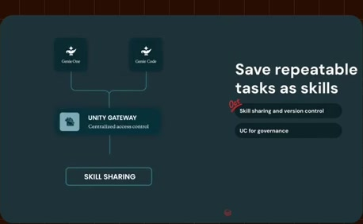
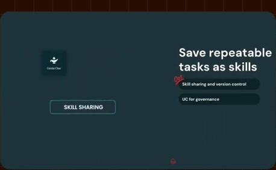
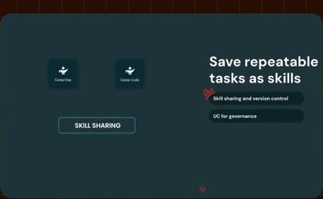
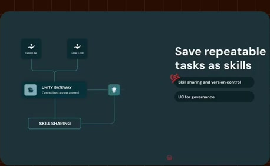
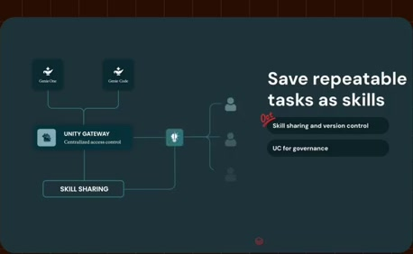
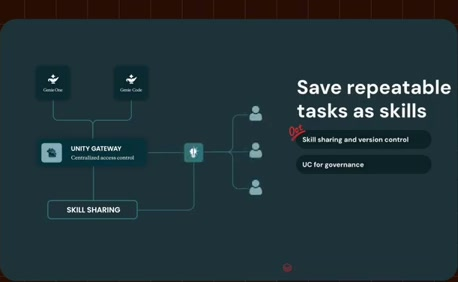
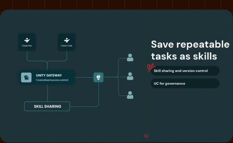

# Skill sharing under a governance layer

**Source:** [22:43.00–23:00.00](https://www.youtube.com/watch?v=HtR5m5VjaDQ) · **Template:** permissioned-action · **Type:** explanatory-graphic-or-overlay

**Teaching purpose:** Explain distribution and governance as a route and control relationship.
**Relationship:** actor → control point → allowed/denied route

## Original transcript

> next thing that we are almost about to announce is skill sharing for Genie 1 and Genie code through Unity Gateway. So, with Unity Gateway, you again can control which skills are available to which users. You'll be able to eventually pin specific skills to different users, so that those are, for example, always available for those end users, especially new users, and so on.

Rolling transcript, approximate times and original transcription errors preserved.

## Parameterized teaching pattern

- `{{actor}} reaches {{tool}} through {{control_point}}, which enforces {{scope}}.`
- `{{action}} is allowed for {{allowed_scope}} and denied for {{denied_scope}}.`

**Use when:** Use when the permission boundary or action route matters.
**Choose another approach when:** Compatibility logos are not proof of authorization or successful execution.

**Proposed adaptation motion:** Establish actor and destination, add the gateway, draw the route and reveal access distinctions.

## Source-specific reveal evidence

```json
{
  "status": "Sequence-level source observations are attached in prior_source_observations. The family motion grammar is a proposed reusable pattern, not a frame-exact claim about this instance."
}
```

## Original source states

### 22:43.30 — earlier observed state

[Full source frame](../frames/full/0040899.jpg)
> next thing that we are almost about to announce is skill sharing for Genie 1 and Genie code through Unity Gateway.

### 22:46.00 — intermediate observed state

[Full source frame](../frames/full/0040980.jpg)
> announce is skill sharing for Genie 1 and Genie code through Unity Gateway. So, with Unity Gateway, you again can

### 22:51.00 — intermediate observed state

[Full source frame](../frames/full/0041130.jpg)
> So, with Unity Gateway, you again can control which skills are available to which users. You'll be able to eventually pin specific skills to

### 22:56.00 — intermediate observed state

[Full source frame](../frames/full/0041280.jpg)
> which users. You'll be able to eventually pin specific skills to different users, so that those are, for example, always available for those end

### 22:59.50 — later observed state

[Full source frame](../frames/full/0041385.jpg)
> different users, so that those are, for example, always available for those end users, especially new users, and so on. But in general, like I mentioned before,

<details>
<summary>3 original change windows: before / near transition / after</summary>

### Estimated anchor 22:43.00

| Before | Near transition | After |
| --- | --- | --- |
|  |  |  |

> next thing that we are almost about to announce is skill sharing for Genie 1 and Genie code through Unity Gateway.

### Estimated anchor 22:51.00

| Before | Near transition | After |
| --- | --- | --- |
|  |  |  |

> So, with Unity Gateway, you again can control which skills are available to which users. You'll be able to eventually pin specific skills to

### Estimated anchor 22:58.00

| Before | Near transition | After |
| --- | --- | --- |
|  |  |  |

> eventually pin specific skills to different users, so that those are, for example, always available for those end users, especially new users, and so on.

</details>
