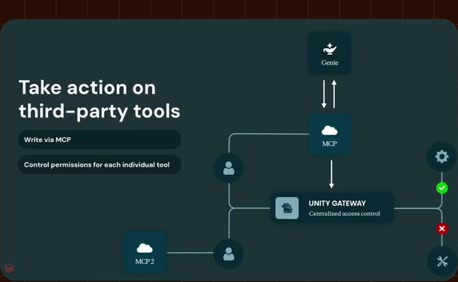
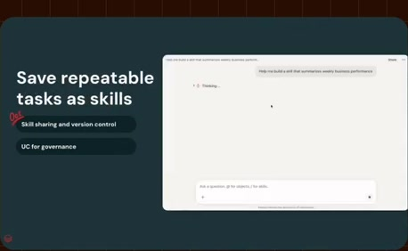
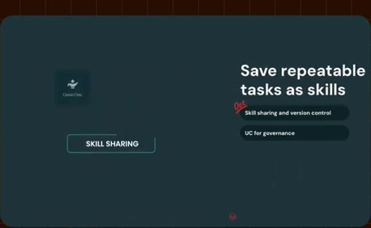
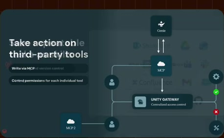

# Save a repeatable task as a skill

**Source:** [22:35.00–22:43.00](https://www.youtube.com/watch?v=HtR5m5VjaDQ) · **Template:** feature-evidence · **Type:** explanatory-graphic-or-overlay

**Teaching purpose:** Support the feature claim with the visible source interface.
**Relationship:** stable capability → supporting product evidence

## Original transcript

> then expanded on that as we think about more and more centralized governance of these agents. And actually, the very next thing that we are almost about to announce is skill sharing for Genie 1

Rolling transcript, approximate times and original transcription errors preserved.

## Parameterized teaching pattern

- `To {{user_job}}, use {{feature}}: {{specific_interaction}}.`
- `Here {{system}} lets {{actor}} {{action}}, with {{constraint}}.`

**Use when:** Use when the actual visible product interaction supports the claim.
**Choose another approach when:** Do not fabricate UI or infer availability beyond the visible source version.

**Proposed adaptation motion:** Hold the heading; update one supporting point as the real interface demonstrates it.

## Source-specific reveal evidence

```json
{
  "status": "Sequence-level source observations are attached in prior_source_observations. The family motion grammar is a proposed reusable pattern, not a frame-exact claim about this instance."
}
```

## Original source states

### 22:35.30 — earlier observed state

[Full source frame](../frames/full/0040659.jpg)
> administrators, and we've only since then expanded on that as we think about more and more centralized governance of these agents. And actually, the very

### 22:38.00 — intermediate observed state

[Full source frame](../frames/full/0040740.jpg)
> more and more centralized governance of these agents. And actually, the very next thing that we are almost about to

### 22:42.50 — later observed state

[Full source frame](../frames/full/0040875.jpg)
> these agents. And actually, the very next thing that we are almost about to announce is skill sharing for Genie 1 and Genie code through Unity Gateway.

<details>
<summary>1 original change windows: before / near transition / after</summary>

### Estimated anchor 22:35.00

| Before | Near transition | After |
| --- | --- | --- |
|  |  |  |

> administrators, and we've only since then expanded on that as we think about more and more centralized governance of these agents. And actually, the very

</details>
