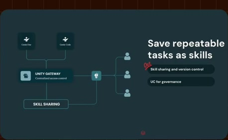
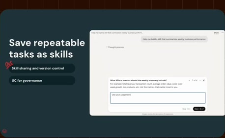
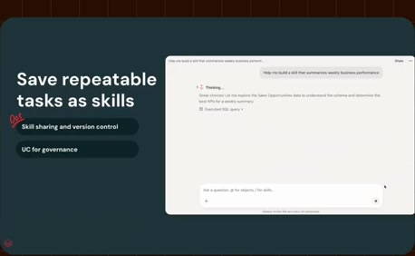
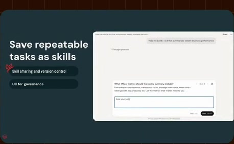
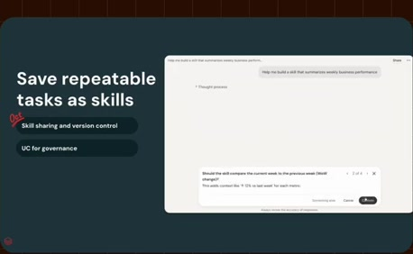

# Return to the skills interface

**Source:** [23:00.00–23:11.00](https://www.youtube.com/watch?v=HtR5m5VjaDQ) · **Template:** feature-evidence · **Type:** explanatory-graphic-or-overlay

**Teaching purpose:** Re-ground the governance explanation in the actual feature surface.
**Relationship:** stable capability → supporting product evidence

## Original transcript

> example, always available for those end users, especially new users, and so on. But in general, like I mentioned before, a skill is a good way to kind of run the same repeatable task the same way over and over uh to share your workflows with your teammates and so on.

Rolling transcript, approximate times and original transcription errors preserved.

## Parameterized teaching pattern

- `To {{user_job}}, use {{feature}}: {{specific_interaction}}.`
- `Here {{system}} lets {{actor}} {{action}}, with {{constraint}}.`

**Use when:** Use when the actual visible product interaction supports the claim.
**Choose another approach when:** Do not fabricate UI or infer availability beyond the visible source version.

**Proposed adaptation motion:** Hold the heading; update one supporting point as the real interface demonstrates it.

## Source-specific reveal evidence

```json
{
  "status": "Sequence-level source observations are attached in prior_source_observations. The family motion grammar is a proposed reusable pattern, not a frame-exact claim about this instance."
}
```

## Original source states

### 23:00.30 — earlier observed state

[Full source frame](../frames/full/0041409.jpg)
> different users, so that those are, for example, always available for those end users, especially new users, and so on. But in general, like I mentioned before, a skill is a good way to kind of run the

### 23:05.00 — intermediate observed state

[Full source frame](../frames/full/0041550.jpg)
> But in general, like I mentioned before, a skill is a good way to kind of run the same repeatable task the same way over and over uh to share your workflows with

### 23:10.00 — later observed state

[Full source frame](../frames/full/0041700.jpg)
> same repeatable task the same way over and over uh to share your workflows with your teammates and so on. >> Can you please share a little bit more

<details>
<summary>1 original change windows: before / near transition / after</summary>

### Estimated anchor 23:05.00

| Before | Near transition | After |
| --- | --- | --- |
|  |  |  |

> But in general, like I mentioned before, a skill is a good way to kind of run the same repeatable task the same way over and over uh to share your workflows with

</details>
