# Sources, ontology and consumer

**Source:** [00:08.00–00:17.00](https://www.youtube.com/watch?v=HtR5m5VjaDQ) · **Template:** converging-sources · **Type:** explanatory-graphic-or-overlay

**Teaching purpose:** Establish a common destination for distinct source classes.
**Relationship:** many inputs → shared hub

## Original transcript

> who is a product leader at Databricks. We are going to be doing a deep dive on Genie ontology and the capabilities for co-working with Genie. Thank you so much for being here, Elise.

Rolling transcript, approximate times and original transcription errors preserved.

## Parameterized teaching pattern

- `{{consumer}} draws on {{source_a}}, {{source_b}} and {{source_c}} to {{job}}.`
- `These inputs differ, but they contribute to the same {{shared_layer}}.`

**Use when:** Use when the distinction among source classes matters and they share a real destination.
**Choose another approach when:** Use a list for unrelated items; label search/query/tool access rather than implying data ingestion.

**Proposed adaptation motion:** Add sources individually, retain earlier nodes, draw each path, then activate the hub.

## Source-specific reveal evidence

```json
{
  "status": "Sequence-level source observations are attached in prior_source_observations. The family motion grammar is a proposed reusable pattern, not a frame-exact claim about this instance."
}
```

## Original source states

### 00:08.20 — earlier observed state
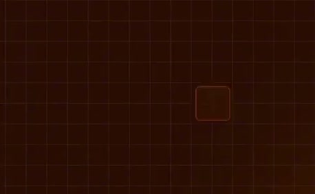
[Full source frame](../frames/full/0000246.jpg)
> who is a product leader at Databricks. We are going to be doing a deep dive on Genie ontology and the capabilities for

### 00:10.00 — intermediate observed state
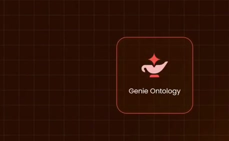
[Full source frame](../frames/full/0000300.jpg)
> who is a product leader at Databricks. We are going to be doing a deep dive on Genie ontology and the capabilities for

### 00:12.00 — intermediate observed state
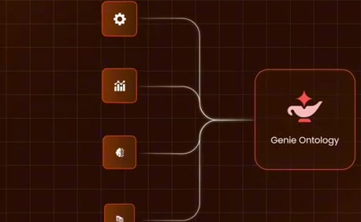
[Full source frame](../frames/full/0000360.jpg)
> We are going to be doing a deep dive on Genie ontology and the capabilities for co-working with Genie. Thank you so much

### 00:14.00 — intermediate observed state
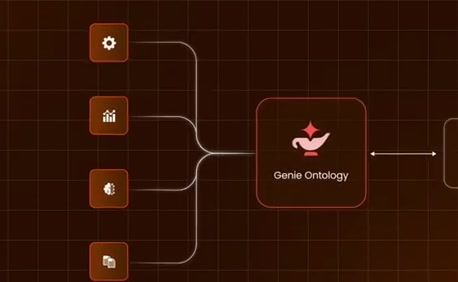
[Full source frame](../frames/full/0000420.jpg)
> We are going to be doing a deep dive on Genie ontology and the capabilities for co-working with Genie. Thank you so much for being here, Elise.

### 00:16.00 — later observed state

[Full source frame](../frames/full/0000480.jpg)
> Genie ontology and the capabilities for co-working with Genie. Thank you so much for being here, Elise. >> Thank you for having me. Excited to talk

<details>
<summary>6 original change windows: before / near transition / after</summary>

### Estimated anchor 00:08.00

| Before | Near transition | After |
| --- | --- | --- |
| 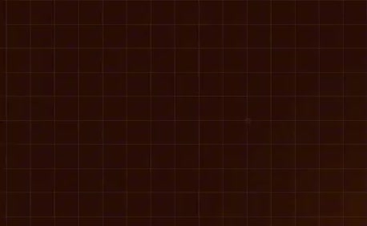 | 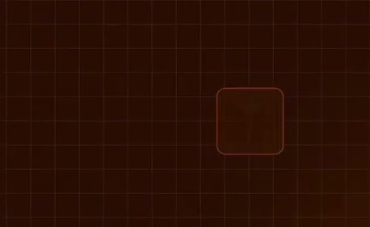 | 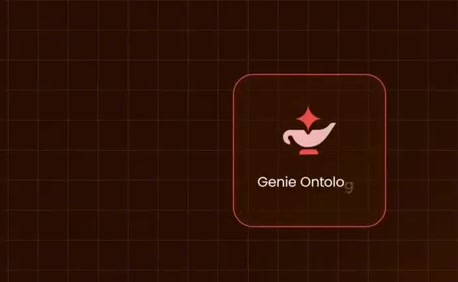 |

> who is a product leader at Databricks. We are going to be doing a deep dive on Genie ontology and the capabilities for

### Estimated anchor 00:09.20

| Before | Near transition | After |
| --- | --- | --- |
| 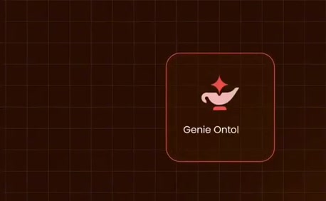 | 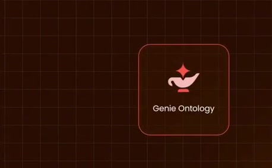 |  |

> who is a product leader at Databricks. We are going to be doing a deep dive on Genie ontology and the capabilities for

### Estimated anchor 00:10.50

| Before | Near transition | After |
| --- | --- | --- |
|  | 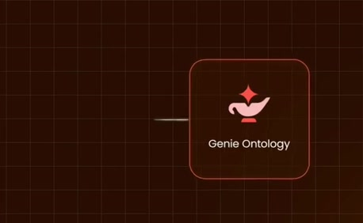 | 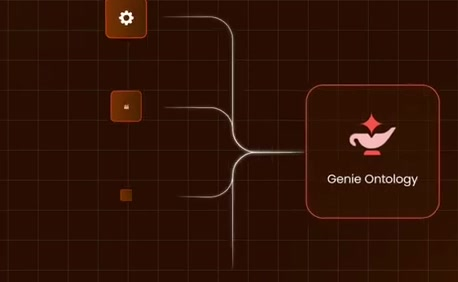 |

> who is a product leader at Databricks. We are going to be doing a deep dive on Genie ontology and the capabilities for

### Estimated anchor 00:12.00

| Before | Near transition | After |
| --- | --- | --- |
| 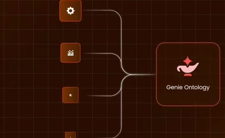 | 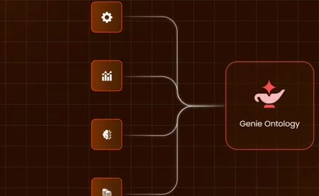 | 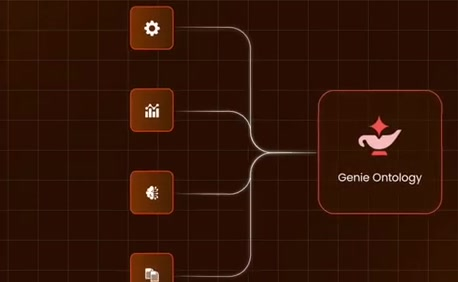 |

> We are going to be doing a deep dive on Genie ontology and the capabilities for co-working with Genie. Thank you so much

### Estimated anchor 00:13.50

| Before | Near transition | After |
| --- | --- | --- |
| 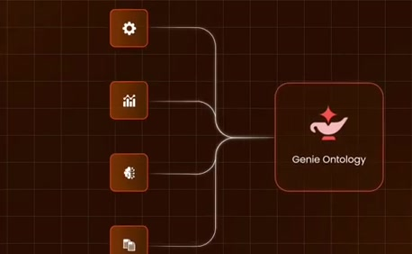 | 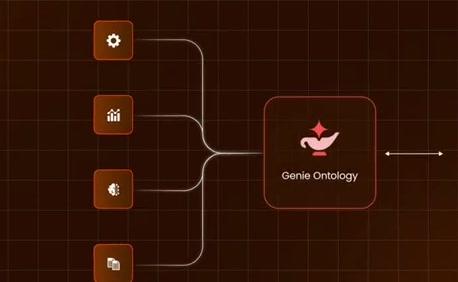 | 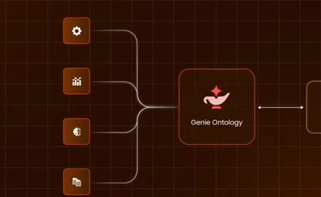 |

> We are going to be doing a deep dive on Genie ontology and the capabilities for co-working with Genie. Thank you so much

### Estimated anchor 00:15.00

| Before | Near transition | After |
| --- | --- | --- |
| 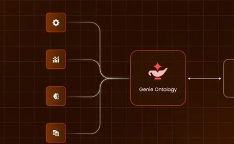 |  |  |

> Genie ontology and the capabilities for co-working with Genie. Thank you so much for being here, Elise.

</details>
