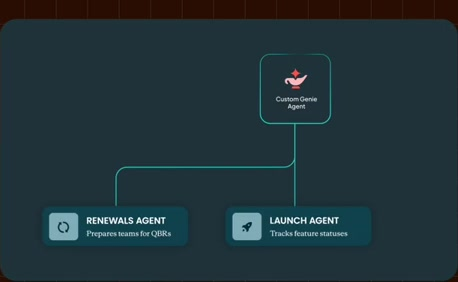
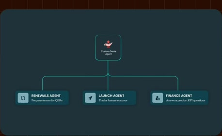
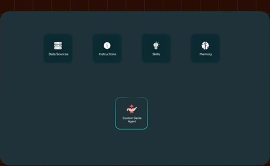
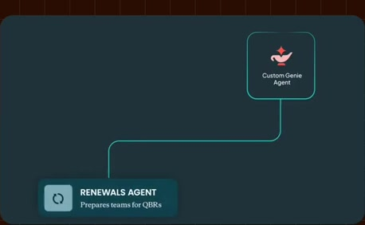
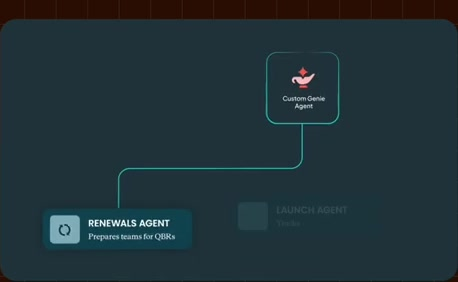
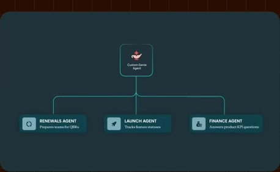

# Renewals, launch and finance agents

**Source:** [24:44.00–25:03.00](https://www.youtube.com/watch?v=HtR5m5VjaDQ) · **Template:** agent-delegation · **Type:** explanatory-graphic-or-overlay

**Teaching purpose:** Make specialization tangible through distinct business jobs.
**Relationship:** parent → specialists → resources

## Original transcript

> coworker that can answer questions or get work done in a very particular domain. So, for example, you might have a a renewals agent that helps your team prep for for QBRs, or a launch agent that helps you kind of track all your feature statuses, or maybe a finance agent that answers questions about about your product's KPIs. And I think most customers are not starting from scratch here. If you've already been using what used to be called Genie Spaces, then

Rolling transcript, approximate times and original transcription errors preserved.

## Parameterized teaching pattern

- `{{parent_agent}} delegates {{job_a}} to {{specialist_a}} and {{job_b}} to {{specialist_b}}.`
- `Each {{specialist}} receives {{inputs}} and can use {{resources}} within {{scope}}.`

**Use when:** Use when delegation or ownership is a real relationship in the supported system.
**Choose another approach when:** Use an input map for context sources; do not present source connectors as subordinate agents.

**Proposed adaptation motion:** Establish the parent or inputs, reveal specialists individually, then show each named branch/resource.

## Source-specific reveal evidence

```json
{
  "status": "Sequence-level source observations are attached in prior_source_observations. The family motion grammar is a proposed reusable pattern, not a frame-exact claim about this instance."
}
```

## Original source states

### 24:44.30 — earlier observed state

[Full source frame](../frames/full/0044529.jpg)
> we might think of as a customized coworker that can answer questions or get work done in a very particular domain. So, for example, you might have a a renewals agent that helps your team

### 24:49.00 — intermediate observed state

[Full source frame](../frames/full/0044670.jpg)
> domain. So, for example, you might have a a renewals agent that helps your team prep for for QBRs, or a launch agent

### 24:53.50 — intermediate observed state

[Full source frame](../frames/full/0044805.jpg)
> a a renewals agent that helps your team prep for for QBRs, or a launch agent that helps you kind of track all your feature statuses, or maybe a finance agent that answers questions about about

### 24:57.00 — intermediate observed state

[Full source frame](../frames/full/0044910.jpg)
> feature statuses, or maybe a finance agent that answers questions about about your product's KPIs. And I think most customers are not starting from scratch

### 25:02.50 — later observed state

[Full source frame](../frames/full/0045075.jpg)
> your product's KPIs. And I think most customers are not starting from scratch here. If you've already been using what used to be called Genie Spaces, then you've actually been creating agents

<details>
<summary>3 original change windows: before / near transition / after</summary>

### Estimated anchor 24:44.00

| Before | Near transition | After |
| --- | --- | --- |
|  |  |  |

> we might think of as a customized coworker that can answer questions or get work done in a very particular domain. So, for example, you might have

### Estimated anchor 24:50.00

| Before | Near transition | After |
| --- | --- | --- |
|  |  |  |

> domain. So, for example, you might have a a renewals agent that helps your team prep for for QBRs, or a launch agent that helps you kind of track all your

### Estimated anchor 24:56.00

| Before | Near transition | After |
| --- | --- | --- |
|  |  |  |

> that helps you kind of track all your feature statuses, or maybe a finance agent that answers questions about about your product's KPIs. And I think most

</details>
