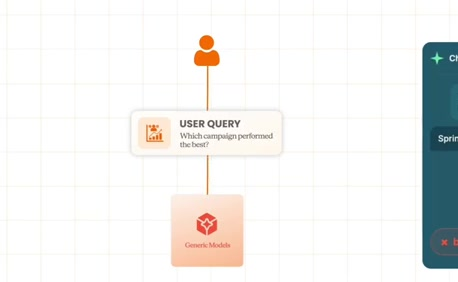
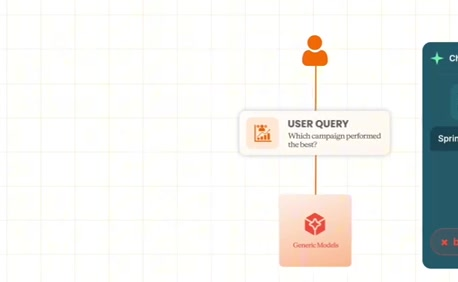
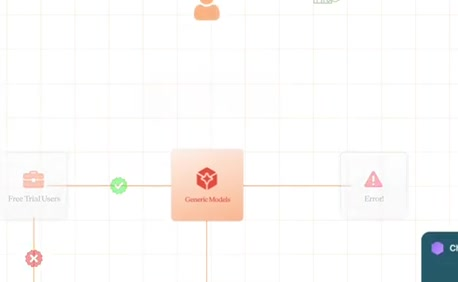
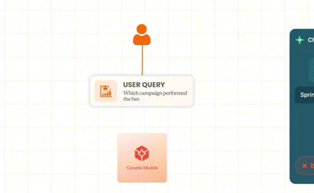
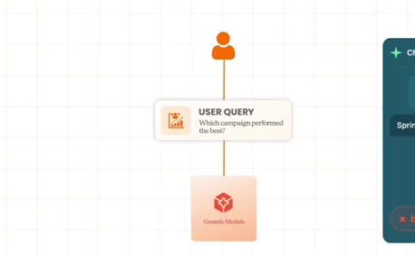
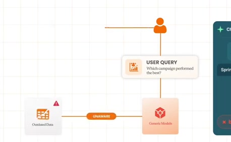
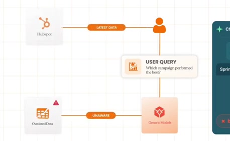

# Campaign answer based on stale data

**Source:** [02:27.00–02:39.30](https://www.youtube.com/watch?v=HtR5m5VjaDQ) · **Template:** stale-context · **Type:** explanatory-graphic-or-overlay

**Teaching purpose:** Distinguish freshness failure from a missing metric definition.
**Relationship:** prior context → change → mismatch

## Original transcript

> free trial exists. Sorry, free trials. Uh or if you ask like, "What campaign is is performing best?" It might have no idea that like the campaigns table is super laggy. So, if you actually want, you know, the latest data, you have to go straight to HubSpot via MCP. And more broadly, all of our companies, you know,

Rolling transcript, approximate times and original transcription errors preserved.

## Parameterized teaching pattern

- `{{asset_or_rule}} changed, but {{system}} still uses {{old_context}}.`
- `The {{entity}} was {{change}}, so the previous {{reference}} is now unreliable.`

**Use when:** Use when time or organizational change breaks relevance.
**Choose another approach when:** A stale icon does not prove freshness checks exist; show the changed reference and its consequence.

**Proposed adaptation motion:** Reveal the original reference, mark the concrete change, then show the resulting mismatch.

## Source-specific reveal evidence

```json
{
  "status": "Sequence-level source observations are attached in prior_source_observations. The family motion grammar is a proposed reusable pattern, not a frame-exact claim about this instance."
}
```

## Original source states

### 02:27.20 — earlier observed state

[Full source frame](../frames/full/0004416.jpg)
> even that the concept of a free met uh a free trial exists. Sorry, free trials. Uh or if you ask like, "What campaign is is performing best?" It might have no

### 02:29.00 — intermediate observed state

[Full source frame](../frames/full/0004470.jpg)
> free trial exists. Sorry, free trials. Uh or if you ask like, "What campaign is is performing best?" It might have no idea that like the campaigns table is

### 02:32.00 — intermediate observed state

[Full source frame](../frames/full/0004560.jpg)
> Uh or if you ask like, "What campaign is is performing best?" It might have no idea that like the campaigns table is super laggy. So, if you actually want,

### 02:35.00 — intermediate observed state

[Full source frame](../frames/full/0004650.jpg)
> idea that like the campaigns table is super laggy. So, if you actually want, you know, the latest data, you have to go straight to HubSpot via MCP. And more

### 02:38.50 — later observed state

[Full source frame](../frames/full/0004755.jpg)
> you know, the latest data, you have to go straight to HubSpot via MCP. And more broadly, all of our companies, you know,

<details>
<summary>4 original change windows: before / near transition / after</summary>

### Estimated anchor 02:27.00

| Before | Near transition | After |
| --- | --- | --- |
|  |  |  |

> even that the concept of a free met uh a free trial exists. Sorry, free trials. Uh or if you ask like, "What campaign is is performing best?" It might have no

### Estimated anchor 02:31.00

| Before | Near transition | After |
| --- | --- | --- |
|  |  |  |

> Uh or if you ask like, "What campaign is is performing best?" It might have no idea that like the campaigns table is super laggy. So, if you actually want,

### Estimated anchor 02:34.00

| Before | Near transition | After |
| --- | --- | --- |
|  |  |  |

> is performing best?" It might have no idea that like the campaigns table is super laggy. So, if you actually want, you know, the latest data, you have to

### Estimated anchor 02:37.00

| Before | Near transition | After |
| --- | --- | --- |
|  |  |  |

> super laggy. So, if you actually want, you know, the latest data, you have to go straight to HubSpot via MCP. And more

</details>
