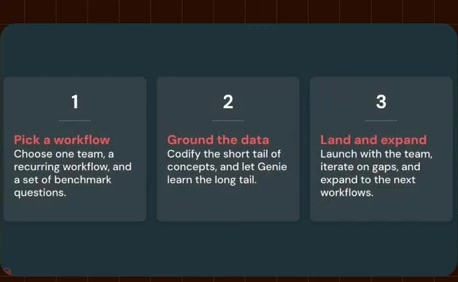
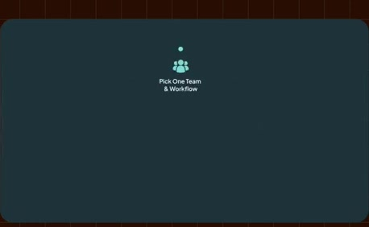
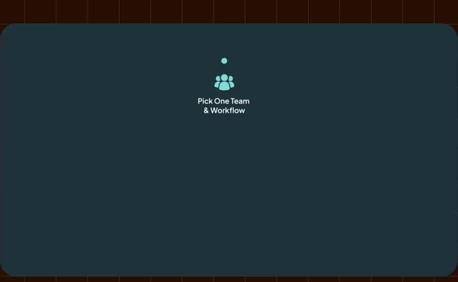
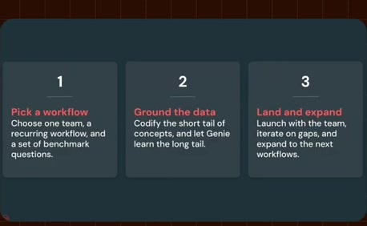
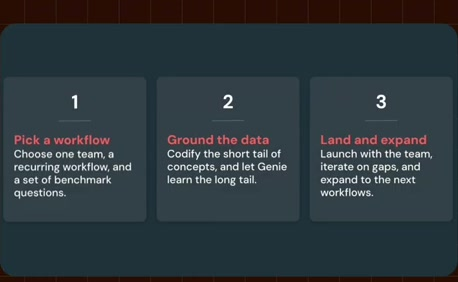
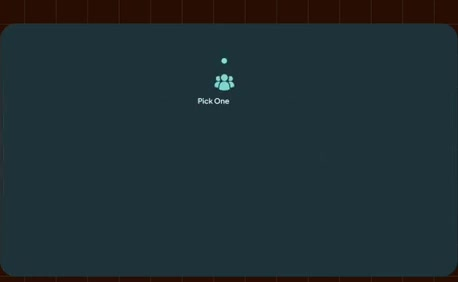

# Pick a workflow, ground the data, land and expand

**Source:** [29:56.50–30:05.00](https://www.youtube.com/watch?v=HtR5m5VjaDQ) · **Template:** peer-categories · **Type:** explanatory-graphic-or-overlay

**Teaching purpose:** Give an equal-weight overview before the detailed rollout sequence.
**Relationship:** equal-rank needs or choices

## Original transcript

> the most out of Genie? >> Yeah, my favorite question. Um so for an initial proof of concept, I I recommend starting with one team and a few common recurring workflows. So that might be, you know, legal reviewing

Rolling transcript, approximate times and original transcription errors preserved.

## Parameterized teaching pattern

- `We need {{need_a}}, {{need_b}} and {{need_c}} for {{goal}}.`
- `There are three distinct concerns: {{concern_a}}, {{concern_b}} and {{concern_c}}.`

**Use when:** Use when equal conceptual rank is the lesson.
**Choose another approach when:** Use a timeline when order matters and a hierarchy when one item contains another.

**Proposed adaptation motion:** Settle one card, make room coherently, then introduce equal peers on a shared baseline.

## Source-specific reveal evidence

```json
{
  "status": "Sequence-level source observations are attached in prior_source_observations. The family motion grammar is a proposed reusable pattern, not a frame-exact claim about this instance."
}
```

## Original source states

### 29:56.70 — earlier observed state

[Full source frame](../frames/full/0053901.jpg)
> how how do people get started to make the most out of Genie? >> Yeah, my favorite question. Um so for an initial proof of concept, I

### 29:59.00 — intermediate observed state

[Full source frame](../frames/full/0053970.jpg)
> >> Yeah, my favorite question. Um so for an initial proof of concept, I I recommend starting with one team and a

### 30:02.00 — intermediate observed state

[Full source frame](../frames/full/0054060.jpg)
> Um so for an initial proof of concept, I I recommend starting with one team and a few common recurring workflows. So that might be, you know, legal reviewing

### 30:04.50 — later observed state

[Full source frame](../frames/full/0054135.jpg)
> I recommend starting with one team and a few common recurring workflows. So that might be, you know, legal reviewing incoming contracts, or maybe finance

<details>
<summary>3 original change windows: before / near transition / after</summary>

### Estimated anchor 29:56.50

| Before | Near transition | After |
| --- | --- | --- |
|  |  |  |

> how how do people get started to make the most out of Genie? >> Yeah, my favorite question. Um so for an initial proof of concept, I

### Estimated anchor 29:59.00

| Before | Near transition | After |
| --- | --- | --- |
|  |  |  |

> >> Yeah, my favorite question. Um so for an initial proof of concept, I I recommend starting with one team and a

### Estimated anchor 30:01.50

| Before | Near transition | After |
| --- | --- | --- |
|  |  |  |

> Um so for an initial proof of concept, I I recommend starting with one team and a few common recurring workflows. So that

</details>
