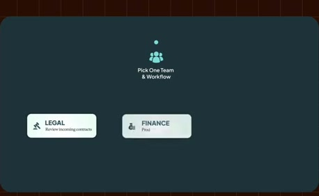
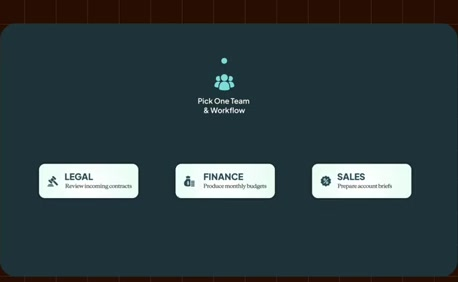
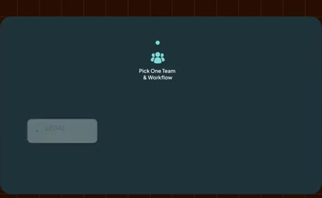
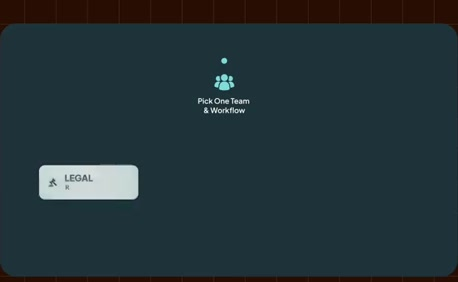
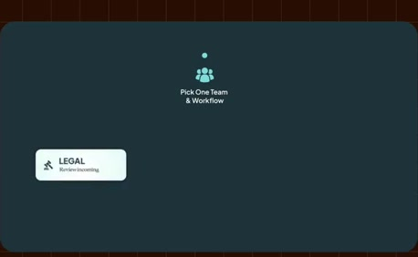
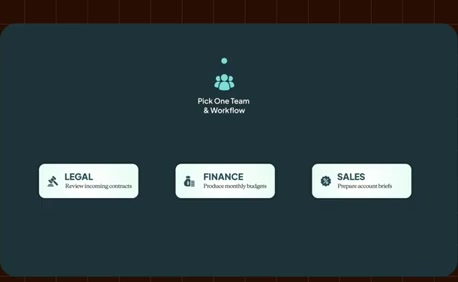

# Pick one team and one recurring workflow

**Source:** [30:05.00–30:25.00](https://www.youtube.com/watch?v=HtR5m5VjaDQ) · **Template:** rollout · **Type:** explanatory-graphic-or-overlay

**Teaching purpose:** Constrain the pilot with concrete team/workflow examples.
**Relationship:** ordered milestones → current step → details

## Original transcript

> few common recurring workflows. So that might be, you know, legal reviewing incoming contracts, or maybe finance producing a monthly budget, or sales prepping their account briefs. Pick the team that has a lot of recurring work, and pick the work that that team already does pretty often, where getting a better answer, having a faster process is really going to make a difference in in their experience. And then once you've picked a workflow,

Rolling transcript, approximate times and original transcription errors preserved.

## Parameterized teaching pattern

- `Start with {{team_and_workflow}}, define {{benchmark}}, measure {{baseline}}, then connect {{sources}} and iterate.`
- `At {{current_step}}, do {{task}} so that {{next_step}} has {{required_input}}.`

**Use when:** Use for a real ordered process with useful current-step context.
**Choose another approach when:** Use peer cards for unordered considerations; a rail is not a promise about calendar duration.

**Proposed adaptation motion:** Retain earlier milestones, activate the next marker, update details below and pan only when space is exhausted.

## Source-specific reveal evidence

```json
{
  "status": "Sequence-level source observations are attached in prior_source_observations. The family motion grammar is a proposed reusable pattern, not a frame-exact claim about this instance."
}
```

## Original source states

### 30:05.30 — earlier observed state

[Full source frame](../frames/full/0054159.jpg)
> I recommend starting with one team and a few common recurring workflows. So that might be, you know, legal reviewing incoming contracts, or maybe finance

### 30:08.00 — intermediate observed state

[Full source frame](../frames/full/0054240.jpg)
> few common recurring workflows. So that might be, you know, legal reviewing incoming contracts, or maybe finance producing a monthly budget, or sales

### 30:15.00 — intermediate observed state

[Full source frame](../frames/full/0054450.jpg)
> prepping their account briefs. Pick the team that has a lot of recurring work, and pick the work that that team already does pretty often, where getting a

### 30:24.50 — later observed state

[Full source frame](../frames/full/0054735.jpg)
> is really going to make a difference in in their experience. And then once you've picked a workflow, I recommend defining benchmarking

<details>
<summary>2 original change windows: before / near transition / after</summary>

### Estimated anchor 30:05.00

| Before | Near transition | After |
| --- | --- | --- |
|  |  |  |

> I recommend starting with one team and a few common recurring workflows. So that might be, you know, legal reviewing incoming contracts, or maybe finance

### Estimated anchor 30:14.00

| Before | Near transition | After |
| --- | --- | --- |
|  |  |  |

> prepping their account briefs. Pick the team that has a lot of recurring work, and pick the work that that team already does pretty often, where getting a

</details>
