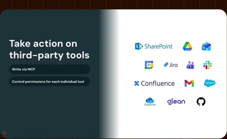
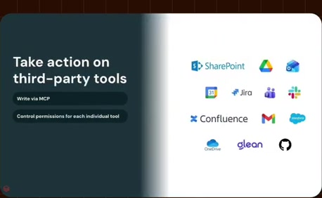
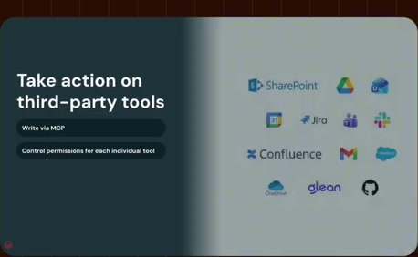

# Third-party work tools

**Source:** [21:48.00–21:56.00](https://www.youtube.com/watch?v=HtR5m5VjaDQ) · **Template:** access-paths · **Type:** explanatory-graphic-or-overlay

**Teaching purpose:** Identify the destinations before explaining action and permissions.
**Relationship:** distinct access modes → different jobs

## Original transcript

> a lot of demand for that, so we are building it. Now, documents might live inside of Genie, but of course, a lot of your work doesn't. So, I talked about MCPs to read in data, but of course, you can also use MCPs to write data.

Rolling transcript, approximate times and original transcription errors preserved.

## Parameterized teaching pattern

- `Use {{access_mode_a}} for {{job_a}}, and {{access_mode_b}} for {{job_b}}.`
- `Finding an existing {{document}} differs from calculating {{answer}} over live {{data}}.`

**Use when:** Use when superficially similar access paths have different semantics.
**Choose another approach when:** A collage of logos cannot distinguish retrieval from execution or ingestion.

**Proposed adaptation motion:** Introduce categories, demonstrate one contrast, then connect the supported paths to a shared consumer.

## Source-specific reveal evidence

```json
{
  "status": "Sequence-level source observations are attached in prior_source_observations. The family motion grammar is a proposed reusable pattern, not a frame-exact claim about this instance."
}
```

## Original source states

### 21:48.30 — earlier observed state

[Full source frame](../frames/full/0039249.jpg)
> a lot of demand for that, so we are building it. Now, documents might live inside of Genie, but of course, a lot of your work

### 21:51.00 — intermediate observed state

[Full source frame](../frames/full/0039330.jpg)
> building it. Now, documents might live inside of Genie, but of course, a lot of your work doesn't. So, I talked about MCPs to read

### 21:55.00 — later observed state

[Full source frame](../frames/full/0039450.jpg)
> Genie, but of course, a lot of your work doesn't. So, I talked about MCPs to read in data, but of course, you can also use MCPs to write data.

<details>
<summary>2 original change windows: before / near transition / after</summary>

### Estimated anchor 21:48.00

| Before | Near transition | After |
| --- | --- | --- |
|  |  |  |

> that's in Databricks, and we are seeing a lot of demand for that, so we are building it. Now, documents might live inside of Genie, but of course, a lot of your work

### Estimated anchor 21:51.00

| Before | Near transition | After |
| --- | --- | --- |
|  |  |  |

> building it. Now, documents might live inside of Genie, but of course, a lot of your work doesn't. So, I talked about MCPs to read

</details>
