# First revenue table versus trusted Finance source

**Source:** [02:05.00–02:18.00](https://www.youtube.com/watch?v=HtR5m5VjaDQ) · **Template:** wrong-source · **Type:** explanatory-graphic-or-overlay

**Teaching purpose:** Expose source authority as the reason a plausible answer can be wrong.
**Relationship:** question → plausible but wrong asset → wrong answer

## Original transcript

> business, we often get quite strange answers. So, for example, it might grab the first revenue table that it finds in some random dashboard rather than the one that finance actually maintains. Uh or if you ask for, you know, a churn rate, it might have no idea that your

Rolling transcript, approximate times and original transcription errors preserved.

## Parameterized teaching pattern

- `For {{business_question}}, {{system}} may select {{easy_but_wrong_asset}} instead of {{authoritative_asset}}.`
- `It finds {{candidate}}, but that is not the {{trusted_definition_or_source}} used by {{owner}}.`

**Use when:** Use when the failure is asset authority or relevance rather than arithmetic.
**Choose another approach when:** Use a definition comparison for metric ambiguity; avoid showing a random table when the problem is a formula.

**Proposed adaptation motion:** Establish candidate assets, highlight the wrong selection, connect it to the answer and expose the error.

## Source-specific reveal evidence

```json
{
  "status": "Sequence-level source observations are attached in prior_source_observations. The family motion grammar is a proposed reusable pattern, not a frame-exact claim about this instance."
}
```

## Original source states

### 02:05.20 — earlier observed state
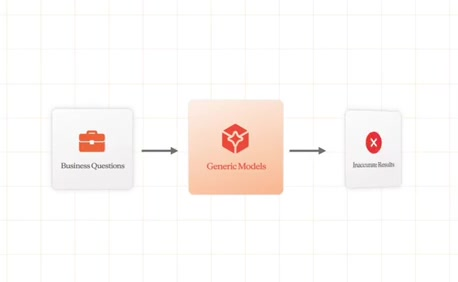
[Full source frame](../frames/full/0003756.jpg)
> we start to ask questions about our business, we often get quite strange answers. So, for example, it might grab

### 02:06.70 — intermediate observed state
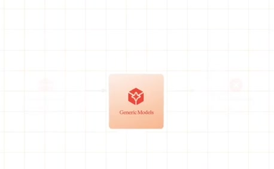
[Full source frame](../frames/full/0003801.jpg)
> we start to ask questions about our business, we often get quite strange answers. So, for example, it might grab the first revenue table that it finds in

### 02:09.00 — intermediate observed state
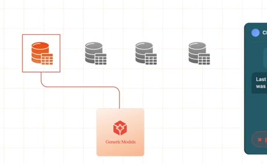
[Full source frame](../frames/full/0003870.jpg)
> business, we often get quite strange answers. So, for example, it might grab the first revenue table that it finds in some random dashboard rather than the

### 02:12.00 — intermediate observed state
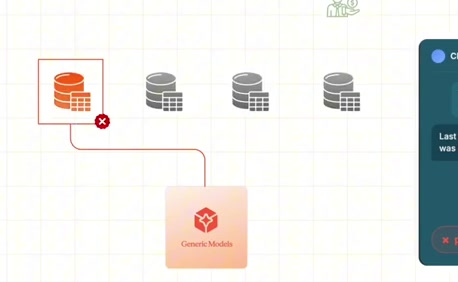
[Full source frame](../frames/full/0003960.jpg)
> the first revenue table that it finds in some random dashboard rather than the one that finance actually maintains. Uh

### 02:16.50 — later observed state

[Full source frame](../frames/full/0004095.jpg)
> some random dashboard rather than the one that finance actually maintains. Uh or if you ask for, you know, a churn rate, it might have no idea that your

<details>
<summary>3 original change windows: before / near transition / after</summary>

### Estimated anchor 02:05.00

| Before | Near transition | After |
| --- | --- | --- |
| 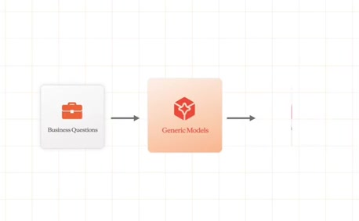 | 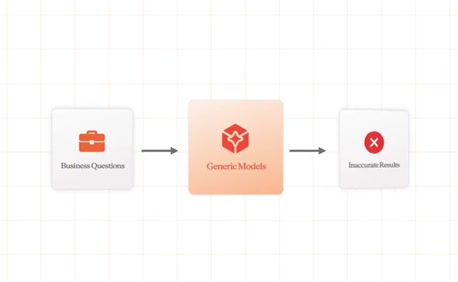 | 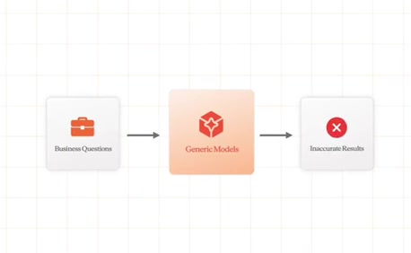 |

> we start to ask questions about our business, we often get quite strange answers. So, for example, it might grab

### Estimated anchor 02:08.00

| Before | Near transition | After |
| --- | --- | --- |
| 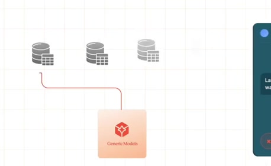 | 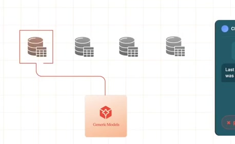 |  |

> business, we often get quite strange answers. So, for example, it might grab the first revenue table that it finds in some random dashboard rather than the

### Estimated anchor 02:12.00

| Before | Near transition | After |
| --- | --- | --- |
| 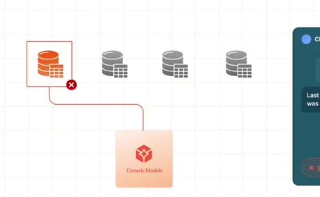 | 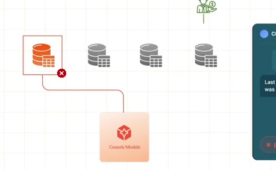 | 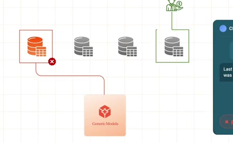 |

> the first revenue table that it finds in some random dashboard rather than the one that finance actually maintains. Uh

</details>
