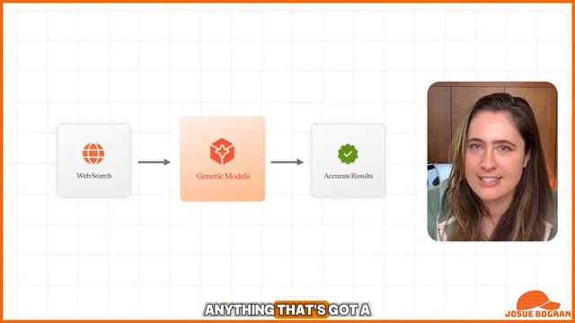
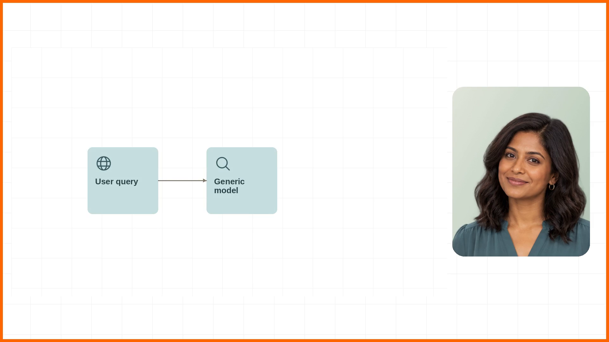
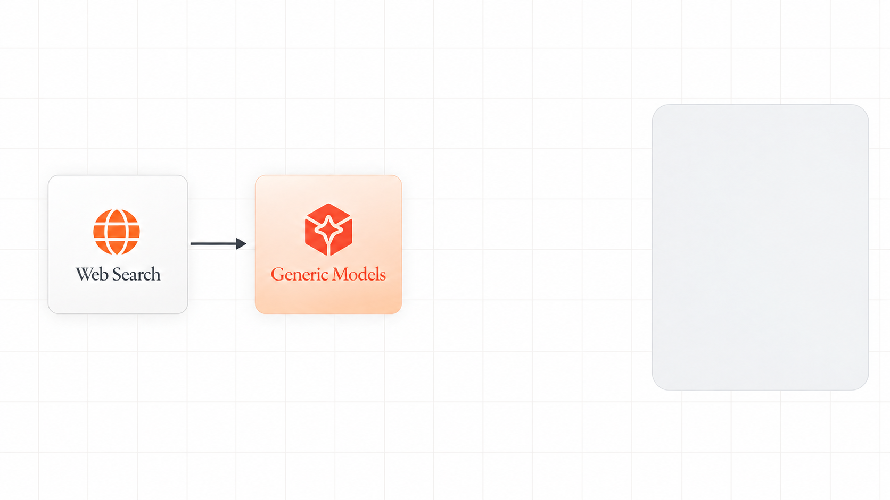

# Image-first storyboard pilot

The previous full-video graphic design was rejected. This pilot follows the revised process: narration → teaching purpose → master image → multiple keyframe images → visual review → editable reconstruction → motion.

[Full process](PROCESS.md) · [Beat, rationale and layer blueprint](web-search/beat.json) · [Storyboard data](storyboard.json)

## Reference and rejected baseline

Source at 01:57:

Rejected reconstruction:

## Three proposed states

Generated image direction for review. The first two images are derived from the same settled master; slight generative differences still require shared tokens in the editable reconstruction. No human visual approval is asserted.

### 1. Input
Identify the input source before showing its route.

**Narration:** Introduce the web-search input as it is named.
**Next motion:** Reveal first connector, then the model surface, icon and label.

### 2. Model
Make the input-to-model relationship visible; the model is the focal object.

**Narration:** Show the generic model using the constrained search input.
**Next motion:** Reveal second connector and result components, then hold the complete flow.

### 3. Result
See the complete input, mechanism and outcome relationship.

**Narration:** Complete the source's constrained-context example before contrasting business questions.
**Next motion:** Reading hold, then the separately storyboarded business-context counterexample.

## Review notes

The warm palette, serif labels, centered filled icons, shadows and fixed composition restore the intended direction. The model-card relative scale, exact label weight, gradient and shadows still need review against the original. The image-first checkpoint exists to resolve these before code and motion.

The right tile reserves presenter space. Exact labels will be editable text. The source's “Accurate Results” applies to its constrained-context example, not all generic-model answers. A separate storyboard must explain the following business-context failure.

## Next deliverable

Reconstruct the chosen still as separate editable background/grid, surfaces, shadows, icons, labels and connectors. Compare the editable still first, then animate one explanation between the selected states with narration cues and reading holds.